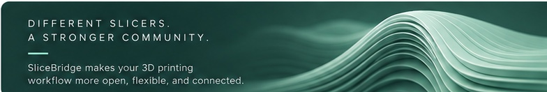

# SliceBridge

**Bridge your prints.**

[English](#english) · [עברית](#hebrew)

## English

A 3D project shouldn't have to be rebuilt for every printer. **SliceBridge** connects Bambu Studio 3MF projects with supported printers and slicers. Choose your targets, convert locally using compatible printer profiles, and continue in the slicer you already know — without changing the original file.

<h2>עברית</h2>

לא צריך להכין מחדש פרויקט תלת־ממדי לכל מדפסת. <strong>SliceBridge</strong> מגשר בין פרויקטי 3MF של Bambu Studio לבין מדפסות וסלייסרים נתמכים. בוחרים מדפסות יעד, ממירים מקומית בעזרת פרופילים תואמים וממשיכים בסלייסר המוכר — בלי לשנות את קובץ המקור.

---

<strong>In development / בפיתוח.</strong> Compatibility depends on installed printer profiles; not yet ready for general release. [Development branch](https://github.com/nocturney/slicebridge/tree/feature/browser-compat-and-icon) · [Printer catalogue roadmap](https://github.com/nocturney/slicebridge/issues/7).
