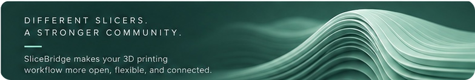

# SliceBridge

**Bridge your prints.**

[English](#english) · [עברית](#hebrew)

## English

A 3D project shouldn't have to be rebuilt for every printer. **SliceBridge** converts Bambu Studio 3MF projects for the printers and slicers you choose. Conversion runs locally, the original file stays unchanged, and you continue in your own slicer.

I put SliceBridge together using existing solutions and AI assistance, adapted to fit my workflow. Hopefully it will be useful to others too.

**Main capabilities**
- **Source:** Bambu Studio 3MF projects, including those from MakerWorld.
- **Built-in targets:** Snapmaker U1, Flashforge Creator 5, ELEGOO Centauri Carbon 2 (CC2) and QIDI Plus5 / X-Plus 5.
- **Installed Orca-family printer:** converts with a matching machine, process and filament profile set already installed on your computer.
- **Generic PrusaSlicer project:** creates a PrusaSlicer 3MF with the bundled MIT-licensed Panda2Prusa converter. You choose the printer and filament profile in PrusaSlicer.

**Verified limits**
- Only the targets above and installed Orca-family profile sets are conversion targets. Bambu Lab printers are not targets.
- The 603-model catalogue is for discovery and selection, not 603 validated conversions.
- SliceBridge does not map a specific Prusa printer and filament profile automatically, and it does not support every slicer.
- Slicer detection finds installed slicer software. It does not certify each printer model.
- Physical print validation is not claimed for every target. Check printer and slicer settings before printing.

**MakerWorld connection:** SliceBridge provides a user-confirmed, guided beta extension setup; no browser-store extension is officially published yet. [Installation instructions](browser-extension/INSTALLATION.md).

<h2>עברית</h2>

לא צריך להכין מחדש פרויקט תלת־ממדי לכל מדפסת. <strong>SliceBridge</strong> ממיר פרויקטי 3MF של Bambu Studio למדפסות וסלייסרים שבוחרים. ההמרה מתבצעת במחשב, הקובץ המקורי נשאר ללא שינוי, וממשיכים בסלייסר שלכם.

הרכבתי את SliceBridge בעזרת פתרונות קיימים וכלי בינה מלאכותית, בהתאמה לצורת העבודה שלי. בתקווה שזה יעזור גם לאחרים.

<strong>עיקרי היכולות</strong>

<ul>
<li><strong>מקור:</strong> פרויקטי 3MF של Bambu Studio, כולל פרויקטים מ-MakerWorld.</li>
<li><strong>יעדים מובנים:</strong> Snapmaker U1, Flashforge Creator 5, ELEGOO Centauri Carbon 2 (CC2) ו-QIDI Plus5 / X-Plus 5.</li>
<li><strong>מדפסת ממשפחת Orca שמותקנת במחשב:</strong> המרה באמצעות סט פרופילים תואם (מכונה, תהליך וחומר) שכבר מותקן במחשב.</li>
<li><strong>פרויקט PrusaSlicer כללי:</strong> יצירת פרויקט PrusaSlicer 3MF בעזרת הממיר Panda2Prusa (רישיון MIT). בוחרים את פרופיל המדפסת והחומר ב-PrusaSlicer.</li>
</ul>

<strong>מגבלות מאומתות</strong>

<ul>
<li>יעדי ההמרה הם המדפסות המובנות, משפחת Orca עם סט פרופילים מותקן תואם, ופרויקט PrusaSlicer כללי. מדפסות Bambu Lab אינן יעד.</li>
<li>קטלוג 603 הדגמים מיועד לגילוי ולבחירה, ולא ל-603 המרות שאומתו.</li>
<li>SliceBridge אינו ממפה אוטומטית פרופיל מדפסת וחומר ספציפי של Prusa, ואינו תומך בכל הסלייסרים.</li>
<li>זיהוי סלייסרים מוצא תוכנות שמותקנות במחשב. הוא אינו מאשר כל דגם מדפסת.</li>
<li>לא נטען שנבדקה הדפסה פיזית בכל יעד. בדקו את הגדרות המדפסת והסלייסר לפני הדפסה.</li>
</ul>

<strong>חיבור MakerWorld:</strong> התקנת תוסף בטא מודרכת באישור המשתמש בלבד. התוסף עדיין אינו בחנות דפדפן רשמית. <a href="browser-extension/INSTALLATION.md">מדריך התקנה</a>.

---

<strong>Development builds available / גרסאות פיתוח להורדה:</strong> [GitHub Releases](https://github.com/nocturney/slicebridge/releases). Experimental builds, not stable releases; some are unsigned. Check printer and slicer settings before printing. [Current source](https://github.com/nocturney/slicebridge/tree/main) · [Printer catalogue details](catalog/README.md).

**Open source:** [GPL-3.0-only](LICENSE) for covered project-owned code · [License scope & rights](LICENSING.md) · [Third-party notices](THIRD_PARTY_NOTICES.md).

**Development milestones:** [Source version](VERSION) · [Changelog](CHANGELOG.md) · [Versioning rules](VERSIONING.md). A development version does not mean there is a published app release.

<strong>אבני דרך בפיתוח:</strong> <a href="VERSION">גרסת המקור</a> · <a href="CHANGELOG.md">יומן שינויים</a> · <a href="VERSIONING.md">כללי גרסאות</a>. סימון גרסת פיתוח לא אומר שפורסמה תוכנה להורדה.

**קוד פתוח:** <a href="LICENSE" dir="ltr">GPL-3.0-only</a> · <a href="LICENSING.md">היקף הרישיון</a> · <a href="THIRD_PARTY_NOTICES.md">קרדיטים לצדדים שלישיים</a>.

